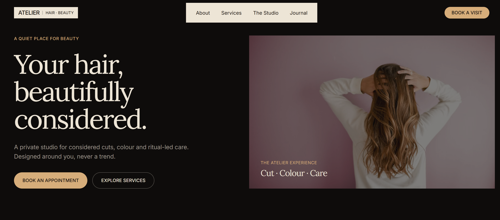

# Atelier — Premium Salon Website

Atelier is a premium editorial salon and beauty studio website built with React and Tailwind CSS. The project focuses on creating a refined, luxury digital experience with elegant typography, intentional whitespace, and smooth motion.

---

## ✨ Overview

Atelier is a modern salon website designed for premium salons, beauty studios, and independent salon brands. The design philosophy embraces an editorial, photography-led aesthetic over conventional SaaS patterns. The user experience is crafted to feel calm, sophisticated, and trustworthy, utilizing a luxury visual approach with considered typography and generous spacing to guide users toward booking a visit.

---

## 🎨 Design Direction

The visual system emphasizes a high-end, luxury salon aesthetic:

- Dark charcoal background paired with warm cream sections
- Champagne/gold accents for primary actions
- **Lora** for elegant, editorial typography (headings and quotes)
- **Inter** for clean UI, body copy, and metadata
- Large editorial headlines with confident whitespace
- Real, high-quality photography instead of generic placeholders
- Subtle borders and gently rounded CTA buttons

---

## 🚀 Features

- Responsive navigation
- Hero section with primary and secondary CTAs
- Atelier Approach section
- Signature Services cards
- Studio showcase
- Artist/team section
- Editorial gallery
- Testimonial section
- Booking CTA
- Footer
- Smooth anchor navigation
- Framer Motion entrance/reveal animations
- Responsive mobile navigation
- Hover/focus states
- Responsive layout across desktop/tablet/mobile

---

## 🛠️ Tech Stack

- React
- Vite
- Tailwind CSS
- Framer Motion
- Lucide React
- JavaScript

---

## 🎞️ Motion & Interaction

The motion system is powered by Framer Motion, utilizing a consistent easing curve across components for a consistent, premium feel. Animations include gentle fade/translate entrances, hero image reveals, and subtle hover scale interactions. Staggered text reveals and a smooth mobile navigation transition add polish without overwhelming the interface.

---

## 📁 Project Structure

```text
atelier/
├── public/
│   └── favicon.svg
├── src/
│   ├── components/
│   ├── App.jsx
│   ├── index.css
│   └── main.jsx
├── .gitignore
├── .oxlintrc.json
├── index.html
├── package.json
├── pnpm-lock.yaml
├── vite.config.js
└── README.md
```

---

## ⚙️ Getting Started

### Installation

```bash
pnpm install
```

### Development

```bash
pnpm dev
```

### Production Build

```bash
pnpm build
```

### Preview

```bash
pnpm preview
```

---

## 📸 Screenshots



---

## 🌐 Live Demo

Live demo: Coming soon

---

## 🧠 What I Focused On

- Visual hierarchy and responsive composition
- Typography scale for an editorial feel
- Accessibility basics
- Component-based React structure
- Reusable animation patterns
- Thoughtful image sizing and responsive image presentation
- Clean repository structure
- Maintaining a premium visual language without overloading the interface

---

## 🔮 Future Improvements

- Real booking integration
- CMS-backed services/team/gallery content
- Journal/blog functionality
- Contact form/backend integration
- Optimized local image delivery
- SEO metadata and Open Graph images
- Analytics
